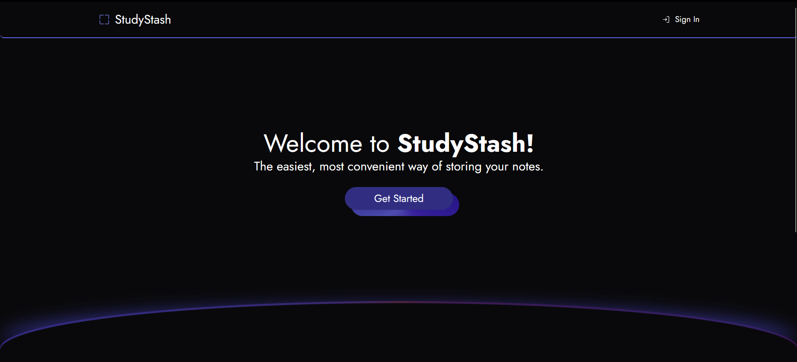

## Welcome to StudyStash 📝

StudyStash is a project made on a whim, as I wanted an easy way to convert pictures I took to PDF. Additionally, I added text file support for even more convenience!

## How to run

- Create the `.env.local` file in your project root and add the following variables
```
NEXT_PUBLIC_CLERK_PUBLISHABLE_KEY=
CLERK_SECRET_KEY=
NEXT_PUBLIC_SUPABASE_URL=
NEXT_PUBLIC_SUPABASE_ANON_KEY=
```
you will need a [`Clerk`](https://clerk.com/) and a [`Supabase`](https://supabase.com/) account.

- Install dependencies by running `npm install`

- To start the server in development mode,

```bash
npm run dev
# or
yarn dev
# or
pnpm dev
# or
bun dev
```

Open [`http://localhost:3000`](http://localhost:3000) with your browser to see the result.

## Screenshots

